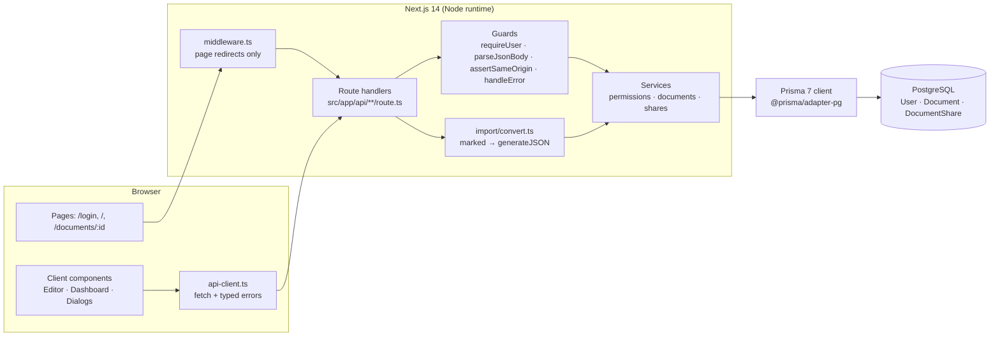
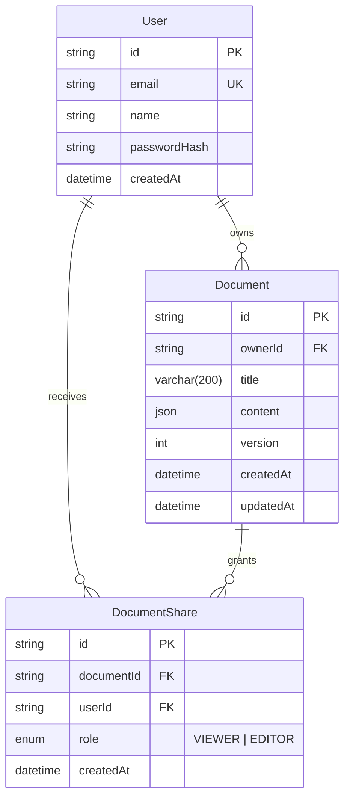
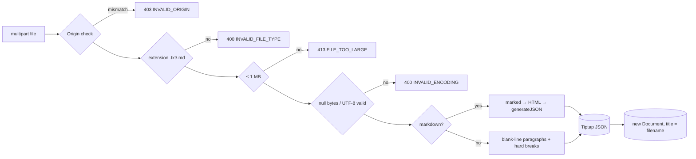

# Architecture

Docket is a single Next.js 14 application (App Router) backed by one PostgreSQL
database. There is no separate backend service, no queue and no realtime layer.

## 1. Request flow



Every mutation follows the same four steps, in this order:

1. `assertSameOrigin(request)` — CSRF guard (cookie auth, so cross-site simple
   requests must be rejected).
2. `requireUser(request)` — verifies the JWT cookie **and** loads the user from
   the database. Middleware is never the only gate.
3. `parseJsonBody(request, schema)` — Zod validation, typed output.
4. A service call that owns the business rule (including permissions), then a
   JSON response or a thrown `AppError` mapped by `handleError`.

## 2. Data model



- `content` is a ProseMirror document: `{ "type": "doc", "content": [...] }`,
  defaulting to a single empty paragraph, capped at 2 MB.
- `DocumentShare` has a unique `(documentId, userId)` so sharing is an idempotent
  upsert; deleting a document or a user cascades to its shares.
- `Document` is indexed on `(ownerId, updatedAt DESC)` for the dashboard and
  `DocumentShare` on `userId` for *Shared with me*.
- The schema also exists as bootstrap DDL in `prisma/sql/init.sql` because the
  Prisma schema-engine binary cannot be downloaded in the offline build sandbox;
  on a networked machine `npx prisma db push` is authoritative.

## 3. Permission model

`src/lib/services/permissions.ts` is the only place permissions are decided:

```ts
getDocumentWithAccess(documentId, userId, "view" | "edit" | "owner")
  → { document, myRole }
```

1. Load the document with the caller's share row (if any).
2. Effective role: `OWNER` when `ownerId === userId`, else the share role, else
   **no access**.
3. No access → `404 NOT_FOUND` (existence never leaks to strangers).
4. Ranking `OWNER(3) > EDITOR(2) > VIEWER(1)`; `view ≥ VIEWER`, `edit ≥ EDITOR`,
   `owner = OWNER`. Insufficient → `403 FORBIDDEN`.

| Operation | Viewer | Editor | Owner | Stranger |
| --- | --- | --- | --- | --- |
| Open document (GET) | 200 | 200 | 200 | 404 |
| Rename / edit content (PATCH) | 403 | 200 | 200 | 404 |
| Delete (DELETE) | 403 | 403 | 204 | 404 |
| List / add / change / revoke shares | 403 | 403 | 200 | 404 |

Frontend restrictions (disabled toolbar, hidden Share button) are UX only. The
`permissions.test.ts` suite proves the server blocks the same calls, and that a
rejected write leaves the stored content and version untouched.

## 4. Autosave and conflict handling

```mermaid
sequenceDiagram
  participant U as User
  participant E as Tiptap editor
  participant A as useAutosave
  participant API as PATCH /api/documents/:id
  participant DB as Postgres

  U->>E: types
  E->>A: onUpdate(doc)  (state: Saving…)
  Note over A: debounce 1s, keep only the latest doc
  A->>API: { content, baseVersion }
  API->>DB: version matches? update + version+1
  DB-->>API: { version, updatedAt }
  API-->>A: 200 → state: Saved just now
  Note over A: one request in flight; edits during the request set a dirty flag
  API-->>A: 409 → state: conflict, banner offers "Reload latest"
```

- **One in-flight request at a time**; a "dirty again" flag re-sends the newest
  document the moment the current request settles (no overlapping writes, no
  lost keystrokes from racing saves).
- Failures retry twice with exponential backoff (500 ms, 1 s), then the status
  pill shows `Save failed – Retry`.
- `beforeunload` flushes pending content with `fetch(..., { keepalive: true })`.
- Last-write-wins overall: `baseVersion` is an optimistic-concurrency check, not
  a merge. Real-time collaboration / CRDT is explicitly out of scope.

## 5. Import pipeline



`convert.ts` is a pure function (`filename, bytes) → {title, content}`) so it is
unit-testable without HTTP. The importer reuses the editor's extension list
(`src/lib/editor/extensions.ts`), which is what strips unknown tags such as
`<script>` instead of storing them. Nothing is written to disk.

## 6. Auth

- Passwords: bcrypt (cost 10) compared with `bcrypt.compare`.
- Session: `jose` HS256 JWT (`sub = userId`, `iss = docket`, 7-day expiry) in an
  httpOnly cookie, `Secure` when `NODE_ENV=production`, `SameSite=Lax`.
- `src/lib/session.ts` is edge-safe and used by middleware; `src/lib/auth.ts`
  adds database lookups (`requireUser`, `getCurrentUser`) for routes and server
  components.
- Login is rate limited in memory (8 failures / 15 min per email). Successful
  logins reset the counter. Failures always return the same generic message.
- Logout clears the cookie; the JWT is stateless, so server-side revocation is
  out of scope for a demo build.

## 7. Error model

```ts
{ "error": { "code": "FORBIDDEN", "message": "...", "fields"?: { field: ["..."] } } }
```

Codes used: `UNAUTHORIZED`, `FORBIDDEN`, `NOT_FOUND`, `VALIDATION_ERROR`,
`INVALID_JSON`, `VERSION_CONFLICT`, `USER_NOT_FOUND`, `CANNOT_SHARE_WITH_SELF`,
`INVALID_FILE_TYPE`, `EMPTY_FILE`, `INVALID_ENCODING`, `FILE_TOO_LARGE`,
`INVALID_ORIGIN`, `TOO_MANY_ATTEMPTS`, `CONFLICT`, `INTERNAL_ERROR`.

`handleError` maps `ZodError → 400`, `AppError → its status`, Prisma errors →
500/409/404 without stack traces, and anything else → a generic 500 (logged
server-side).

## 8. Decisions and trade-offs

| Decision | Why | Trade-off |
| --- | --- | --- |
| **Last-write-wins + `version`** instead of CRDT/OT | 240-minute budget, no realtime requirement; a 409 banner is honest and testable | Concurrent editors can lose an edit; recovery is "reload latest" |
| **REST route handlers** instead of tRPC/server actions | The contract was specified as HTTP routes; easy to exercise with `curl` and by calling handlers directly in tests | Hand-written DTO mapping |
| **Custom JWT** (`jose` + bcrypt) instead of Supabase Auth | The brief asked for it; keeps the demo users self-contained and the permission model ours | No refresh-token rotation, no revocation, no OAuth |
| **Server-side import** (`marked` + `@tiptap/html`) | One code path for API and UI; no giant HTML strings through the client; unknown tags dropped by the schema | Node runtime needed for `generateJSON` (fine on Vercel's Node functions) |
| **Text stored as ProseMirror JSON** | The editor is the source of truth; no HTML sanitisation problem, no `dangerouslySetInnerHTML` | Not human-readable in the database |
| **Permissions in one service** | Impossible to forget a check in a new route | Every route pays one extra query (document + share) |
| **Prisma 7 driver adapter** (`@prisma/adapter-pg`) | Prisma 7 is engine-free, so no Rust binary download is needed at build time in this environment | Extra `pg` dependency and a `prisma.config.ts` |
| **In-memory rate limiting** | No extra infrastructure for a demo | Per-instance on Vercel |
| **Middleware redirects only** | Middleware can be bypassed for API routes; every handler re-checks | Slightly more code per route |

## 9. Assumptions

- Seeded demo users only; one shared password; no sign-up or password reset.
- Sharing targets an existing user by email (unknown email → `USER_NOT_FOUND`).
- Only the owner can share, change roles, revoke or delete.
- Editors may rename documents and edit content; viewers are read-only.
- Import is `.txt`/`.md`, ≤ 1 MB, UTF-8, no null bytes; the title is the filename
  without its extension.
- Documents are soft-scoped to a single workspace; there are no organisations,
  folders or tags.
- Desktop-first UI, usable at 375 px (sidebar collapses into a drawer).

## 10. Out of scope

Real-time collaboration, comments, version history, export (PDF/DOCX), images,
tables, DOCX import, email notifications, audit logs, multi-tenant orgs.
